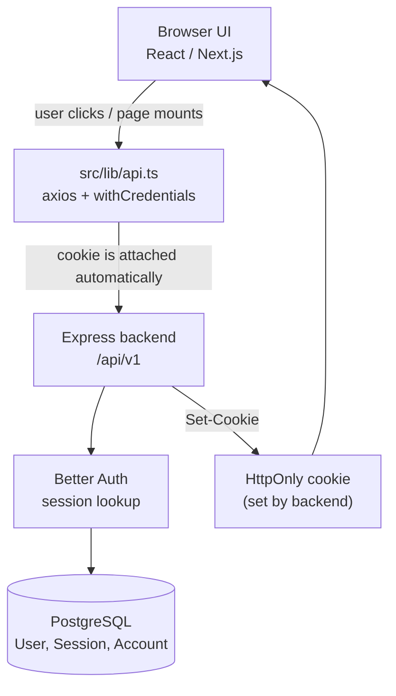
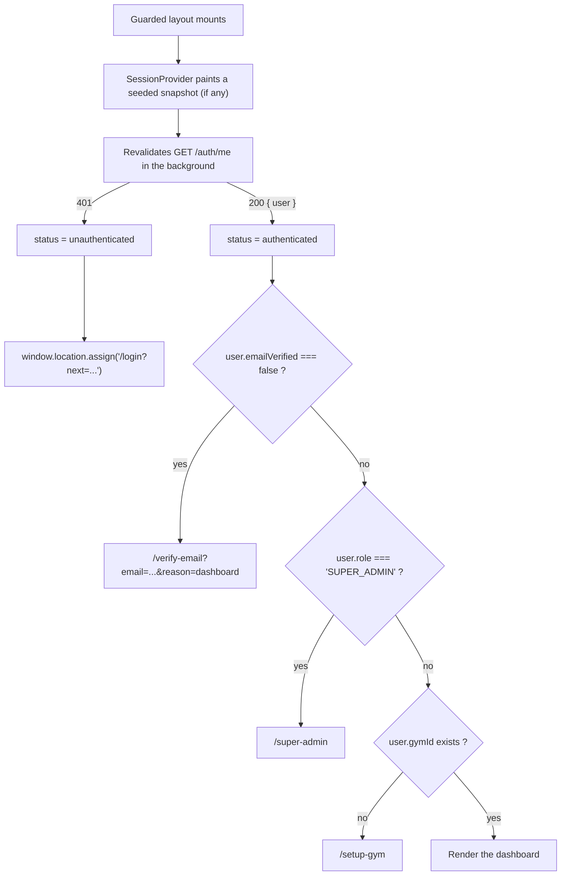
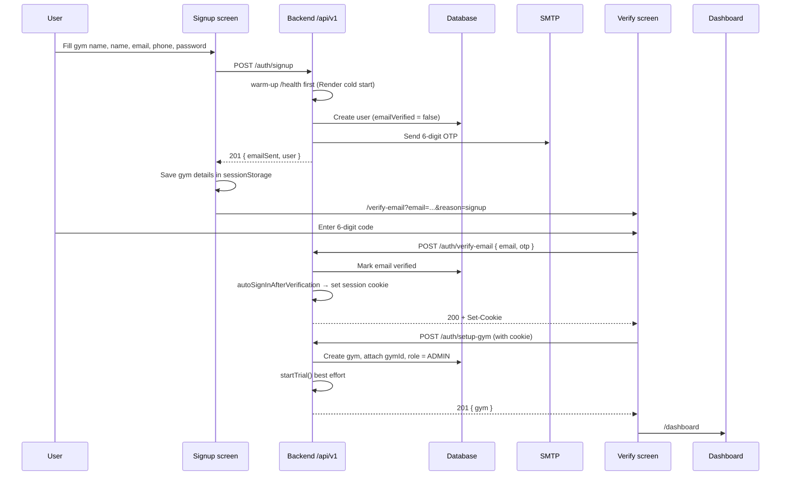
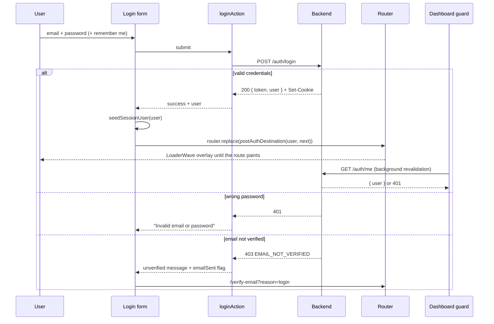
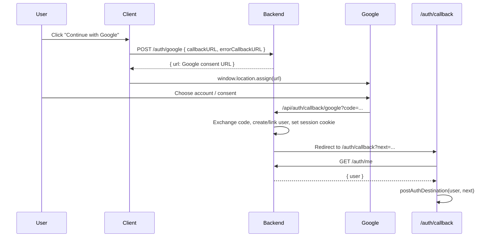
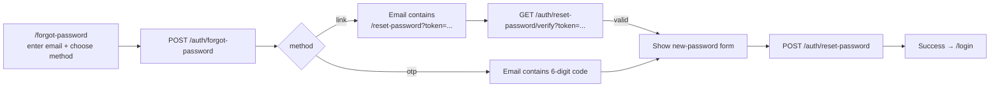

# Authentication & Auth Guards — Complete Guide

This document explains **how authentication works in the DarkGoldGym client** and **how the route guards decide where a user goes**. It is written to be read by a human: first the mental model, then each flow step by step, then the edge cases and debugging notes.

> **Short version**
>
> - The browser never stores a login token in JavaScript.
> - The backend sets an **HttpOnly session cookie** after login / OTP verification / Google sign-in.
> - Every API call is sent with `withCredentials: true`, so the browser attaches that cookie automatically.
> - `SessionProvider` asks the backend “who am I?” with `GET /auth/me`. After a password login it paints the user from the login response immediately and revalidates `/auth/me` in the background.
> - `AuthGuard` (gym area) and `SuperAdminGuard` (platform console) use the answer to redirect the user.
> - **The client guards are only UX.** The real security boundary is the Express backend, which re-checks the session, email verification, role, gym ownership and subscription on every request.

---

## 1. The mental model

Think of authentication as three separate layers:



### Layer 1 — UI state (React)

`SessionProvider` holds three possible values:

| Status | Meaning |
| --- | --- |
| `loading` | “I have no snapshot yet; I am waiting for the backend’s answer.” |
| `authenticated` | A snapshot from the login response is being shown, and/or the backend returned a user. |
| `unauthenticated` | The backend said 401, or the request failed with no snapshot to keep. |

Nothing is saved to `localStorage` or `sessionStorage`. The only client-side snapshot is an in-memory module variable (`src/lib/session-cache.ts`) that disappears on a reload, so a refresh or a new tab always re-checks the session with the backend.

### Layer 2 — The HTTP layer (axios)

`src/lib/api.ts` creates one axios client:

```ts
export const apiClient = axios.create({
  baseURL: API_BASE,        // NEXT_PUBLIC_API_URL + /api/v1
  withCredentials: true,    // send/receive cookies
  headers: { "Content-Type": "application/json" },
  timeout: 30000,
});
```

Every request goes through `apiRequest()`, which:

- unwraps the backend’s `{ data: ... }` envelope,
- converts failures into a typed `ApiError` with `status`, `code`, `details`, `payload`,
- retries transient timeouts/network errors **once for GET and idempotent auth calls**,
- never retries mutations automatically (so a member/payment is not created twice).

### Layer 3 — The backend (the real gatekeeper)

The backend uses **Better Auth**. Its session cookie is `HttpOnly`, so JavaScript cannot read or steal it. For every protected request the backend:

1. Reads the session cookie.
2. Loads the user from the database.
3. Rejects unverified emails (`403 EMAIL_NOT_VERIFIED`).
4. Rejects users without a gym (`403`).
5. Reads `role` and `gymId` **from the database row**, never from the request body, so a tampered request cannot claim another role or gym.
6. Applies role permissions and subscription entitlement checks.

---

## 2. Where the session lives

| Item | Where it lives | Accessible to JavaScript? |
| --- | --- | --- |
| Session token | HttpOnly cookie set by the backend | **No** |
| Current user object | React state inside `SessionProvider` | Yes, but only in memory |
| Pending gym details during signup | `sessionStorage` key `darkgold:pending-signup` | Yes — contains only email/gym name/phone/address |
| Passwords | Never stored in the client | — |
| OAuth / SMTP secrets | Backend environment only | — |

The backend cookie configuration (`backend/src/lib/auth.ts`):

- cookie prefix: `gym-crm`
- session lifetime: **7 days**
- cross-site deployments (e.g. frontend on Vercel, API on Render) use `SameSite=None; Secure`, otherwise `SameSite=Lax`
- CORS allows credentials from configured client origins

> Because the app is a **Next.js static export** in production and has **no Next.js middleware**, there is no server-side route protection in the frontend. All frontend redirects are client-side. The backend is what actually protects the data.

---

## 3. File map — where everything lives

| Concern | File |
| --- | --- |
| Axios client, API endpoints, error normalization, redirect helpers | `src/lib/api.ts` |
| Form actions for login / OTP resend / password reset / gym setup | `src/lib/auth-actions.ts` |
| Session context + gym route guard | `src/components/auth/SessionProvider.tsx` |
| In-memory optimistic session snapshot (tab-only) | `src/lib/session-cache.ts` |
| Short-lived dashboard view cache (30 s, per gym/user) | `src/lib/dashboard-cache.ts` |
| Branded five-bar loader | `src/components/loaders/loaderwave.tsx` |
| Platform owner guard | `src/components/super-admin/SuperAdminGuard.tsx` |
| Login screen | `src/app/(auth)/login/screen.tsx` + `src/components/auth/LoginForm.tsx` |
| Signup screen | `src/app/(auth)/signup/screen.tsx` + `src/components/auth/SignupForm.tsx` |
| Email OTP screen | `src/app/(auth)/verify-email/screen.tsx` + `src/components/auth/OtpVerificationForm.tsx` |
| Google OAuth callback | `src/app/(auth)/auth/callback/screen.tsx` |
| Gym onboarding | `src/app/(auth)/setup-gym/screen.tsx` |
| Forgot / reset password | `src/app/(auth)/forgot-password/screen.tsx`, `src/app/(auth)/reset-password/screen.tsx` |
| Gym area layout (guard mounted here) | `src/app/(dashboard)/layout.tsx` |
| Platform console layout (guard mounted here) | `src/app/(super-admin)/layout.tsx` |
| Sign-out buttons | `src/components/TopNavbar.tsx`, `src/components/super-admin/SuperAdminShell.tsx` |
| Role-based sidebar | `src/components/Sidebar.tsx`, `src/lib/nav.ts` |
| Role constants | `src/lib/staff.ts` |
| Trial / subscription banner | `src/components/TrialBanner.tsx` |
| Backend auth routes | `backend/src/routes/auth.route.js` |
| Backend auth controller | `backend/src/controllers/auth.controller.js` |
| Backend session / role middleware | `backend/src/middleware/auth.js`, `backend/src/middleware/requireAuth.ts` |
| Backend permission matrix | `backend/src/middleware/permissions.js` |
| Backend subscription gate | `backend/src/middleware/subscription.js` |
| Better Auth configuration | `backend/src/lib/auth.ts` |

---

## 4. The two guards

### 4.1 Gym auth guard — `AuthGuard`

Mounted in `src/app/(dashboard)/layout.tsx`:

```tsx
<SessionProvider>
  <AuthGuard>
    <KBarProviderWrapper>
      <AppShell>{children}</AppShell>
      <AddMemberEventHandler />
    </KBarProviderWrapper>
  </AuthGuard>
</SessionProvider>
```

So **every route under `(dashboard)`** — `/dashboard`, `/members`, `/payments`, `/settings`, etc. — is wrapped by it.

Decision flow:



While it is deciding, the user sees a full-screen `LoaderWave` state:

- “Checking your session…”
- “Redirecting to sign in…”
- “Verify your email to continue…”
- “Opening platform console…”
- “Finishing your setup…”

When a snapshot from the login response exists, the shell renders immediately and none of those states appear first.

Important details:

- Redirects use `window.location.assign(...)`, which performs a full navigation. That intentionally clears any cached client state.
- The `next` parameter preserves where the user was trying to go, e.g. `/login?next=%2Fpayments`.
- A network error is treated as unauthenticated **when there is no snapshot**. With a snapshot the session is kept, because the backend still rejects any request if the cookie is actually gone.
- The guard checks the **session once when the layout mounts**. The Next.js layout persists across in-app navigation, so it does not re-check on every route change.
- Concurrent `fetchCurrentUser()` calls share one request, so two components asking at the same moment cannot produce duplicate `/auth/me` traffic.

### 4.2 Platform owner guard — `SuperAdminGuard`

Mounted in `src/app/(super-admin)/layout.tsx`.

It is similar but stricter:

| Situation | Result |
| --- | --- |
| `unauthenticated` | `/login?next=/super-admin/...` |
| `emailVerified === false` | `/verify-email?email=...&reason=dashboard` |
| `role !== "SUPER_ADMIN"` | The user’s normal destination (dashboard or `/setup-gym`) |
| `role === "SUPER_ADMIN"` | Render the platform console |

This means a gym owner who manually types `/super-admin` is politely sent back to their own dashboard. A receptionist is treated the same way. The backend also independently rejects every `/api/v1/super-admin/*` request from a non-admin.

---

## 5. The central redirect rule — `postAuthDestination()`

All successful auth entry points (password login, OTP verification, Google callback, gym setup) use the same function so the rules cannot drift apart.

Precedence order:

| Order | Condition | Destination |
| --- | --- | --- |
| 1 | No user | `/login?next=...` |
| 2 | `emailVerified === false` | `/verify-email?...&reason=dashboard` |
| 3 | `role === "SUPER_ADMIN"` | `/super-admin` (or the requested super-admin path) |
| 4 | `!gymId` | `/setup-gym` |
| 5 | Otherwise | The requested page, sanitized with `safeNext()` |

### Open-redirect protection

`safeNext(raw)` only accepts **same-app paths**:

- must start with `/`
- rejects `//evil.com` and `/\evil.com`
- rejects whitespace, quotes, backslashes, `<>`, and control characters
- rejects auth/onboarding pages (`/login`, `/signup`, `/verify-email`, `/auth/callback`, `/forgot-password`, `/reset-password`, `/setup-gym`) to prevent redirect loops
- falls back to `/dashboard`

`loginUrlWithNext()` uses the same sanitizer, so `?next=` cannot be used to bounce a user to an external site.

---

## 6. Complete authentication flows

### 6.1 Email signup → OTP → gym setup



Detailed notes:

1. **`SignupForm` calls the API directly**, not through a form action, because it needs custom handling for `409`, `requiresEmailVerification`, and timeout messages.
2. It calls `warmUpApi()` on mount and before submitting. Render free instances sleep; without a warm-up the first request can time out even though the account is created.
3. The backend may answer `200` with `requiresEmailVerification: true` if the email already exists **but was never verified**. In that case:
   - no duplicate account is created,
   - a fresh OTP is sent,
   - the user continues to `/verify-email`.
4. A verified email that already has an account returns `409 EMAIL_ALREADY_REGISTERED`, and the form suggests signing in instead.
5. Gym details (gym name, phone, address) are kept in `sessionStorage` only between signup and verification. They are cleared after gym creation or when the user starts over.
6. `POST /auth/setup-gym`:
   - requires an authenticated session (`authenticate` middleware),
   - creates the gym and sets the user’s `gymId` + `role = "ADMIN"` in one transaction,
   - starts the one-time trial (best effort),
   - returns `409` if the account already has a gym.

### 6.2 Email + password login



Key behavior:

- The login screen deliberately **does not** probe `/auth/me` on mount. A signed-out visitor should not generate an expected 401 on every visit.
- The login response already contains the signed-in user, so the form **does not wait for `/auth/me`** before navigating. That removes one full round-trip from the critical path.
- `seedSessionUser(user)` stores an in-memory, tab-only snapshot. The dashboard layout reads it on mount, paints the app shell on the first frame, and then revalidates `/auth/me` in the background.
- The `LoaderWave` overlay (`z-[100]`, below the toast viewport) appears as soon as the credentials succeed, so the redirect never looks frozen.
- If the cookie was not accepted (cross-site cookie blocking, wrong API origin), the background revalidation returns `401`, the snapshot is cleared, and the guard sends the user back to `/login`.
- `rememberMe` defaults to `true` in the UI and is sent to the backend.

### 6.3 Google sign-in



Important points:

- The client **never sees** the Google client secret or the OAuth code exchange. Those happen on the backend.
- Google verifies the email, so Google-created accounts are already `emailVerified = true` and skip the OTP screen.
- `callbackURL` and `errorCallbackURL` must belong to an allowed frontend origin; the backend rejects anything else. This prevents OAuth redirect abuse.
- OAuth errors are mapped to friendly messages on the callback page (cancelled, state mismatch, email not found, account already linked, etc.).
- A fresh Google user has no `gymId`, so `postAuthDestination()` sends them to `/setup-gym`.

### 6.4 Forgot password

The user chooses one of two delivery methods:

| Method | What the backend sends | How the reset is completed |
| --- | --- | --- |
| `link` (default) | An email with a link to `/reset-password?token=...` | The page verifies the token, then posts `{ token, newPassword }` |
| `otp` | A 6-digit code | The user enters email + code + new password |

Flow:



Security details:

- `/auth/forgot-password` always returns a neutral message for unknown emails, so it cannot be used to discover which emails have accounts.
- If the email exists but SMTP delivery fails, the backend returns `502` and the UI shows a real error instead of pretending success.
- A reset link is checked **before** the form is shown, so an expired/used link is rejected immediately.
- The reset link token and the OTP flow are both handled by Better Auth on the backend.
- The UI shows a resend cooldown (60 seconds) for the OTP reset flow.

### 6.5 Logout

`SessionProvider.signOut()`:

1. Calls `POST /auth/logout` (retried once because it is idempotent).
2. Clears the in-memory session snapshot and the dashboard view cache.
3. Clears local React state (`user = null`, `status = "unauthenticated"`).
4. Navigates with `window.location.assign("/login")`.

The full navigation is intentional: it throws away every cached client state, not just the session context.

Even if the logout request fails, the client still clears local state and navigates away. The backend cookie will expire or be replaced on the next login.

### 6.6 Refresh / returning to the app

1. The guarded layout mounts.
2. `SessionProvider` calls `GET /auth/me`.
3. The browser attaches the HttpOnly cookie automatically.
4. Backend returns the user, or `401`.
5. `AuthGuard` / `SuperAdminGuard` applies the redirect table.

A full reload has no in-memory snapshot, so the user sees the `LoaderWave` “Checking your session…” state until `/auth/me` answers. Client-side navigations inside the dashboard reuse the already-resolved session and do not call `/auth/me` again.

There is **no global 401 interceptor**. If the session expires while the user is already inside the dashboard, the next data request fails with `ApiError` and the screen shows “Your session has expired. Please sign in again.” A page reload (or visiting a route that remounts the guarded layout) sends them to `/login`. This is a deliberate simple design, not a hidden auto-refresh mechanism.

---

## 7. What state means what

Onboarding is **derived from two user fields**, not stored as a separate “step”:

| `emailVerified` | `gymId` | `role` | Where the user belongs |
| --- | --- | --- | --- |
| `false` | any | any | `/verify-email` |
| `true` | `null` | `SUPER_ADMIN` | `/super-admin` |
| `true` | `null` | `ADMIN` / `RECEPTIONIST` | `/setup-gym` |
| `true` | set | `SUPER_ADMIN` | `/super-admin` |
| `true` | set | `ADMIN` / `RECEPTIONIST` | `/dashboard` (or the requested page) |

The backend enforces the same rules:

- `authenticate` rejects unverified users with `403 EMAIL_NOT_VERIFIED`.
- `requireGym` rejects users without a `gymId`.
- The session alone is never enough.

---

## 8. Route groups and what is protected

| Route | Layout | Protected? | How |
| --- | --- | --- | --- |
| `/` | root layout | Public | Marketing landing page |
| `/login`, `/signup`, `/verify-email`, `/forgot-password`, `/reset-password`, `/setup-gym`, `/auth/callback` | `(auth)/layout.tsx` | Public (some self-redirect if already signed in) | `AuthLayout` only |
| `/dashboard`, `/members`, `/memberships`, `/attendance`, `/payments`, `/expenses`, `/plans`, `/reports`, `/staff`, `/settings` | `(dashboard)/layout.tsx` | Yes | `SessionProvider` + `AuthGuard` + backend |
| `/super-admin`, `/super-admin/gyms`, `/super-admin/owners`, `/super-admin/activity`, `/super-admin/schedule-calls`, `/super-admin/settings` | `(super-admin)/layout.tsx` | Yes, SUPER_ADMIN only | `SessionProvider` + `SuperAdminGuard` + backend |

Self-redirecting auth screens:

- `/verify-email` calls `/auth/me`; if the user is already fully signed in **and has a gym**, it redirects them away.
- `/setup-gym` calls `/auth/me`; it redirects unverified users to `/verify-email`, users with a gym to `/dashboard`, super admins to `/super-admin`, and signed-out users to `/login?next=/setup-gym`.

---

## 9. Roles and permissions

There are three roles in the system:

| Role | Human meaning | Main abilities |
| --- | --- | --- |
| `ADMIN` | Gym owner / full control of one gym | Read, create, update, delete, manage staff, manage subscription |
| `RECEPTIONIST` | Gym staff account | Read and create only |
| `SUPER_ADMIN` | SaaS platform operator | Cross-gym platform administration only |

### Where roles are enforced

| Layer | What it does |
| --- | --- |
| Sidebar (`src/lib/nav.ts` + `src/components/Sidebar.tsx`) | Hides owner-only items. `Staff` is marked `roles: ["ADMIN"]`. The backend still rejects a receptionist who calls the staff API directly. |
| Top navbar | Displays “Owner” or “Receptionist” based on `user.role`. |
| `SuperAdminGuard` | Sends non-super-admins away from `/super-admin`. |
| Backend `authenticate` / `requireAuth` | Loads the role from the database on every request. The role cannot be supplied by the client. |
| Backend `permissions.js` | Central role → permission map. |
| Backend route stacks | Example: `authenticate → requireGym → allowReadAndCreateOnly → requireActiveSubscription`. |

Backend permission map (`backend/src/middleware/permissions.js`):

```text
ADMIN        → read, create, update, delete, staff:manage, subscription:manage
RECEPTIONIST → read, create
SUPER_ADMIN  → platform:manage
```

Additional backend rules:

- `DELETE /members/:id` and `DELETE /expenses/:id` require `ADMIN`.
- `POST /staff/receptionists` requires `staff:manage` (`ADMIN` only).
- Subscription checkout/verify/cancel/history require `subscription:manage`.
- Every gym query is filtered by `req.user.gymId`, so a role never grants access to another gym’s data.
- `SUPER_ADMIN` can never create a gym through `setup-gym`; the backend returns `403 SUPER_ADMIN_CANNOT_CREATE_GYM`.
- The `role` field is `input: false` in Better Auth, so a signup request cannot set `SUPER_ADMIN`. Promotion is done out-of-band.

---

## 10. Subscription / trial gating

Authentication answers “who are you?”. Subscription gating answers “is this gym allowed to use the paid features right now?”.

- The client shows `TrialBanner` on the dashboard. It calls `GET /subscription/me` and displays trial days / renewal date / suspension status.
- The banner is **informational**. It does not hide the dashboard or block pages.
- The backend applies `requireActiveSubscription()` to gym-data routes: members, memberships, payments, expenses, plans, reports, attendance, staff.
- When the trial or paid period has ended, those endpoints return:

```json
{
  "error": "Subscription required",
  "code": "SUBSCRIPTION_REQUIRED",
  "reason": "TRIAL_EXPIRED",
  "message": "Your free trial has expired. Please subscribe to continue..."
}
```

with HTTP `402`. The client normalizes this to “Your subscription has expired. Please renew to continue.”

Billing and recovery routes intentionally stay available even when entitlement is expired, so the owner can pay or renew. This includes subscription plans, checkout, verify, history, and cancel.

---

## 11. Error handling — what the user sees and why

All API failures become `ApiError` objects. The most important ones:

| Status | Typical backend meaning | Client behavior |
| --- | --- | --- |
| `0` | Network error / timeout / server unreachable | “Can't reach the server…” and a retry may happen automatically for GET/idempotent calls |
| `401` | No session, expired session, wrong password | Login form shows invalid credentials; a protected request shows “session expired”; guarded pages redirect to `/login` |
| `402` | Subscription/trial expired | “Your subscription has expired…” |
| `403 EMAIL_NOT_VERIFIED` | Session exists but email is unverified | Redirect to `/verify-email`; login sends a fresh OTP |
| `403` (other) | Wrong role, no gym, permission denied | Friendly “You don't have access…” or the backend message |
| `404` | Record/route not found | “The requested record was not found.” |
| `409` | Email already registered / gym already exists | Specific messages and next-step links |
| `429` | Rate limit | “Too many attempts. Please wait…” |
| `502` | Email delivery failed | “We couldn't send the reset/verification email…” |

### OTP-specific errors

| Backend code | Meaning | UI message |
| --- | --- | --- |
| `OTP_EXPIRED` | 5-minute code expired | “That code has expired. Request a new one.” |
| `TOO_MANY_ATTEMPTS` | 3 wrong attempts | “Too many attempts. Request a new code.” |
| `INVALID_OTP` | Wrong 6-digit code | “Invalid code. Check the 6-digit code…” |
| `INVALID_TOKEN` | Password reset link bad/expired | “This reset link is invalid or has expired.” |

### Login-specific handling

`loginAction` in `src/lib/auth-actions.ts`:

```text
403 + code EMAIL_NOT_VERIFIED → unverified flow (OTP screen)
401                           → "Invalid email or password"
network (status 0)            → "Can't reach the server..."
anything else                 → server message or generic error
```

If the backend also failed to send the OTP, it returns `emailSent: false`; the UI then tells the user to use “Resend OTP” instead of pretending an email went out.

---

## 12. Security model — what actually protects the data

| Protection | How it works |
| --- | --- |
| Session theft via XSS | Session cookie is `HttpOnly`; JavaScript cannot read it. |
| Cross-site request forgery | `SameSite` cookie policy + backend CORS with credentials. Cross-site deployments use `SameSite=None; Secure`. |
| Cookie blocked by browser | Login navigates immediately from the response; the guard's background `/auth/me` returns `401` and the user is sent back to `/login`. |
| Unverified accounts | Backend middleware rejects every gym-data request with `403 EMAIL_NOT_VERIFIED`. |
| Role tampering | Roles are read from the database; the client cannot submit a role. |
| Cross-gym access | Every query is scoped by `req.user.gymId`; there is no gym ID in the client payload for gym data. |
| Open redirects | `safeNext()` only allows same-app paths. |
| OAuth redirect abuse | Backend validates `callbackURL` / `errorCallbackURL` against configured client origins. |
| Account enumeration | Forgot-password and resend-OTP return neutral messages for unknown accounts. |
| Brute force | Backend rate limits (e.g. super-admin login, OTP resend) plus OTP attempt limits. |
| Duplicate mutations on retry | `apiRequest` retries only GET and idempotent auth calls; POST mutations are not auto-retried. |

### What the client guard is **not**

`AuthGuard` and `SuperAdminGuard` are **not** the security boundary.

- They run in the browser, so a user could disable JavaScript or modify the page.
- The UI hiding `/staff` from a receptionist is convenience, not security.
- The backend independently checks every request.

This is the correct design: never trust the client.

---

## 13. Configuration and deployment notes

### Client `NEXT_PUBLIC_API_URL`

The client reads `NEXT_PUBLIC_API_URL`, appends `/api/v1` unless it is already present, and rejects localhost values on purpose (the project is configured to always talk to the deployed API).

Because the app is statically exported, this value is **inlined at build time**. Changing it requires a rebuild.

### Backend environment

The backend needs, among others:

- `BETTER_AUTH_URL` — the **API** origin (not the frontend origin)
- `CLIENT_ORIGIN` — comma-separated allowed frontend origins
- `PUBLIC_API_URL` — optional explicit API origin override
- Google OAuth client ID/secret
- SMTP credentials
- database URL

`backend/src/lib/origins.ts` normalizes these and handles the common Render mistake where `BETTER_AUTH_URL` was pointed at the frontend.

### Cross-site cookie checklist

For a frontend on one host and an API on another:

1. API must be HTTPS.
2. API must send `SameSite=None; Secure` (the backend does this automatically for cross-site setups).
3. `CLIENT_ORIGIN` on the backend must include the exact frontend origin (scheme + host + port, no path).
4. The browser must allow third-party cookies for the API site.
5. `NEXT_PUBLIC_API_URL` must point at the same API origin that sets the cookie.
6. The Google OAuth redirect URI must be registered on the **API** host: `/api/auth/callback/google`. On the custom-domain deployment that is `https://darkgoldgym.duckdns.org/api/auth/callback/google`; on Render it is `https://gym-managment-system-7yiu.onrender.com/api/auth/callback/google`. Register both if both are reachable, and make sure the host in `NEXT_PUBLIC_API_URL` is one of them.

---

## 14. Debugging checklist

When login “works” but the user is bounced back to `/login`, check in this order:

1. **Network tab → `POST /auth/login`** — is there a `200`?
2. **Response headers** — is there a `Set-Cookie` for the session?
3. **Network tab → `GET /auth/me`** — does it return `200` with a user, or `401`?
4. **Cookies** — is the cookie present for the API domain? Is it marked `Secure` on an HTTPS site?
5. **Console** — any CORS error? A CORS failure means the backend’s `CLIENT_ORIGIN` does not match the page origin.
6. **`NEXT_PUBLIC_API_URL`** — correct scheme/host, no accidental `/api/v1` duplication (it is handled, but check anyway), and not localhost.
7. **Third-party cookies** — if the frontend and API are on different sites, the browser may block the API cookie. Allow it or deploy them on the same site.
8. **Backend origin config** — `BETTER_AUTH_URL` must be the API origin. If it points at the frontend, Google callbacks and cookies break.

Common symptom → likely cause:

| Symptom | Likely cause |
| --- | --- |
| `POST /auth/login` 200, then bounced back to `/login` | Cookie not stored (cross-site / SameSite / wrong API origin); background `/auth/me` returned 401 |
| CORS error in console | Backend `CLIENT_ORIGIN` missing the frontend origin |
| Login redirects to `/verify-email` | Account email is not verified |
| Login redirects to `/setup-gym` | User has no `gymId` yet |
| Gym owner sees `/super-admin` redirect loop | Wrong role in the database; check `User.role` |
| Google redirects to an API error page | `BETTER_AUTH_URL` or Google redirect URI is wrong |
| Google shows “Access blocked: This app's request is invalid” (`Error 400: redirect_uri_mismatch`) | The API host the client calls is not registered on the Google OAuth client. Check “error details” for the `redirect_uri` value and add that exact URI (e.g. `https://darkgoldgym.duckdns.org/api/auth/callback/google`) |
| Dashboard loads but every widget says “subscription expired” | Backend returns `402 SUBSCRIPTION_REQUIRED` |
| Receptionist gets 403 on save/delete | Backend role permissions: staff can only read and create |
| “Session expired” after being idle | 7-day session or cookie was dropped; sign in again |

---

## 15. How to make common changes

| Goal | Where to change |
| --- | --- |
| Add a new protected gym page | Create it under `src/app/(dashboard)/...`; the layout’s guards apply automatically |
| Add a new platform page | Create it under `src/app/(super-admin)/...`; `SuperAdminGuard` applies automatically |
| Change post-login routing | Edit `postAuthDestination()` in `src/lib/api.ts` |
| Change the guard redirect rules | Edit `AuthGuard` in `src/components/auth/SessionProvider.tsx` |
| Hide a nav item from staff | Add `roles: ["ADMIN"]` in `src/lib/nav.ts` (and enforce it on the backend) |
| Add a new auth API call | Add the request function in `src/lib/api.ts`, then call it from a screen/action |
| Change OTP length/expiry/attempts | Backend `backend/src/lib/auth.ts` (`emailOTP` config) |
| Change session length | Backend `backend/src/lib/auth.ts` (`session.expiresIn`) |
| Change cookie behavior | Backend `backend/src/lib/auth.ts` (`advanced` / cookie attributes) |
| Change trial/subscription blocking | Backend `backend/src/middleware/subscription.js` and the route stacks |

---

## 16. FAQ

**Does the client store a JWT?**
No. There is no token in JavaScript. The backend uses an HttpOnly session cookie.

**Why does a refresh keep me signed in?**
The cookie is still valid. `SessionProvider` calls `GET /auth/me` on mount and restores the user object.

**Why am I sent to `/verify-email` even though I have a session?**
A session can exist before the email is verified. The backend allows the session but blocks gym data until verification. The client mirrors that with a redirect.

**Why am I sent to `/setup-gym`?**
You are verified and signed in, but your account has no `gymId` yet. This is normal for a fresh email signup that has not finished onboarding, or a fresh Google signup.

**Why does a super admin never see gym onboarding?**
The redirect logic checks `role === "SUPER_ADMIN"` before checking `gymId`, and the backend explicitly rejects `setup-gym` for super admins.

**Can a receptionist open `/staff` by typing the URL?**
They can load the page, but the backend rejects the data calls with `403` because the staff router requires `staff:manage`. The sidebar also hides the link.

**What happens if the backend is asleep (Render free tier)?**
Signup warms the API first and uses a longer timeout. GETs retry once. The UI shows a “server is waking up” timeout message if it still fails.

**Is there Next.js middleware protecting routes?**
No. The app has no `middleware.ts`, and production uses static export. Protection is the client guard for UX plus the backend for real enforcement.

**Does the client support a separate super-admin login page?**
The backend exposes `POST /api/v1/auth/super-admin/login`, but the current client login form uses the shared `POST /auth/login` and routes the user by role afterward. The dedicated endpoint is available for a future dedicated login screen.

---

## 17. Login-to-dashboard performance

The critical path is `POST /auth/login` → dashboard paint. Everything else is deferred:

| Step | Before | Now |
| --- | --- | --- |
| Login → route change | Waited for a second `GET /auth/me` | Uses the `user` from the login response |
| Dashboard guard | Another `GET /auth/me` before rendering children | Paints the seeded snapshot, revalidates in the background |
| Dashboard widgets | Skeleton until all four endpoints answer | Shell and chrome paint first; KPI placeholders resolve progressively |
| Returning to `/dashboard` within 30 s | Full refetch and skeleton flash | Cached view paints immediately, then refreshes silently |
| Duplicate `/auth/me` calls | One per caller | Concurrent callers share a single in-flight request |

Two small caches make this safe:

- `session-cache.ts` is **memory-only** and never persisted. It is seeded from a backend-authenticated response (login, OTP, gym setup) and is always revalidated. A `401` clears it immediately.
- `dashboard-cache.ts` is **memory-only**, keyed by `${gymId}:${userId}`, expires after 30 seconds, and is cleared on sign-out and account changes. Its data is only ever a paint hint; every mutation still goes to the backend.

Neither cache changes authorization: the Express middleware still validates the session, email, role, gym ownership and subscription on every request.

---

## 18. One-page summary

```text
┌─────────────────────────────────────────────────────────────────────┐
│ 1. USER SIGNS IN                                                    │
│    email/password  → POST /auth/login                               │
│    signup + OTP    → POST /auth/signup → POST /auth/verify-email    │
│    Google          → POST /auth/google → Google → /auth/callback    │
│                                                                     │
│ 2. BACKEND SETS AN HttpOnly SESSION COOKIE                          │
│    The browser stores it automatically. JS never sees the token.    │
│                                                                     │
│ 3. CLIENT PAINTS, THEN REVALIDATES                                 │
│    POST /auth/login already returned { user }                       │
│    → seed the in-memory snapshot → navigate immediately             │
│    GET /auth/me then revalidates in the background                  │
│    → 200 { user }  → authenticated                                  │
│    → 401           → unauthenticated                                │
│                                                                     │
│ 4. GUARD DECIDES                                                    │
│    unauthenticated → /login?next=...                                │
│    unverified      → /verify-email                                  │
│    SUPER_ADMIN     → /super-admin                                   │
│    no gym          → /setup-gym                                     │
│    otherwise       → requested dashboard page                       │
│                                                                     │
│ 5. EVERY DATA REQUEST IS RE-CHECKED BY THE BACKEND                  │
│    session → verified email → gym → role → subscription             │
│                                                                     │
│ 6. SIGNOUT                                                          │
│    POST /auth/logout → clear local state → full reload to /login    │
└─────────────────────────────────────────────────────────────────────┘
```

The guiding principle is simple:

> **The client makes authentication pleasant. The backend makes it secure.**

---

*Last reviewed against the client `src/` tree and the backend auth routes/middleware in this repository.*
